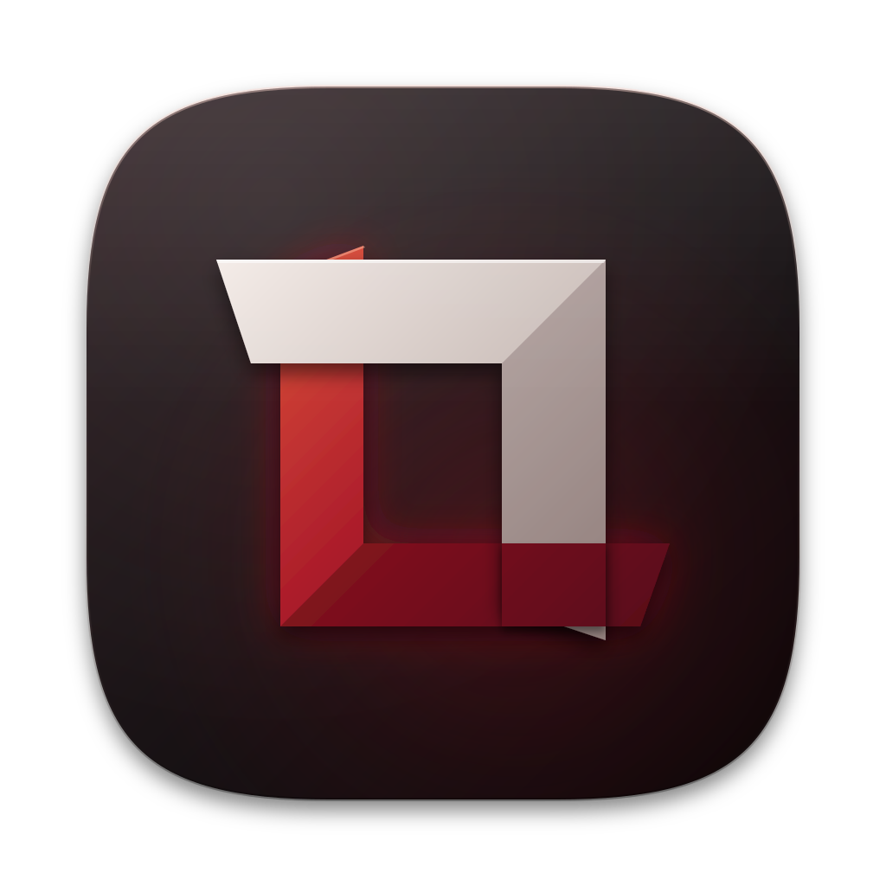

# Melete

<p align="center">
  
</p>

[English](README.md) | 日本語

Melete は、筋力トレーニングなどの運動を記録する macOS アプリです。種目ごとに記録する数値項目を定義し、日付ごとの運動履歴を振り返れます。

## 機能

- 種目の作成・名前変更・アーカイブ・復帰。
- 種目ごとに、単位、整数または小数（小数第3位まで）、必須または任意を設定した数値項目を定義できます。項目を今後の入力フォームで使用するかどうかも切り替えられます。
- 1日に複数の種目とセットを記録でき、セットごとに異なる値を保存できます。カレンダー付きの履歴から運動・種目記録・セットを確認、編集、削除できます。
- 通常の運動・種目データは SwiftData を使ってローカルに保存します。クラウド同期、バックアップ、エクスポート、インポート機能はありません。

チャット画面は固定台本のデモです。入力した文章は無視され、ネットワーク通信やAI推論は行わず、運動データとは別のメモリ内ストアを使います。実際のChatGPTログインとAI推論は利用できません。OAuthおよびResponses API関連のコードは、チャット機能に接続されていない基礎実装です。V2のデータ処理は実験的で、隔離した検証用であり、通常の実データ利用向けではありません。

目標、分析、通知、同期は未実装です。

## 必要環境とビルド

- macOS 14.0以降（`project.yml` のdeployment target）。
- macOS SDKを含むXcode。
- 必要に応じてXcodeプロジェクトを再生成するためのXcodeGen。

追跡対象の `Melete.xcodeproj` を使ってXcodeからビルドできます。プロジェクト定義は `project.yml` にあります。定義を変更した場合は、生成済みプロジェクトを手編集せず、XcodeGenで再生成してください。

```sh
xcodegen generate
```

`Melete` schemeでアプリをビルドします。

```sh
xcodebuild -project Melete.xcodeproj -scheme Melete build
```

`project.yml` で宣言しているSwift Package Manager依存関係は JOSESwift 3.0.0 と SwiftNIO 2.105.0 です。プロジェクトの準備・ビルド時にXcodeがパッケージを解決します。

ビルドで確認できるのはコンパイルであり、アプリの実行や既存の実データに対する動作ではありません。通常の `Melete` アプリを実行すると、通常のローカルSwiftDataストアを使用します。安全なテスト手順と隔離ストアの要件は [AGENTS.md](AGENTS.md) を参照してください。実データに対して無制限にテストを実行しないでください。

## データと制限

運動・種目データはSwiftDataを使ってローカルに保存します。通常アプリの構成はV1です。実験的なV2経路は隔離した検証用であり、サポートされた移行方法や、実データを使う通常の実行経路として扱わないでください。バックアップ・復旧機能はありません。ビルドに成功しても、既存データを開く・変更する・移行する安全性が確認されたことにはなりません。

リポジトリ固有のビルド方法と隔離テストの案内は [AGENTS.md](AGENTS.md) を参照してください。
