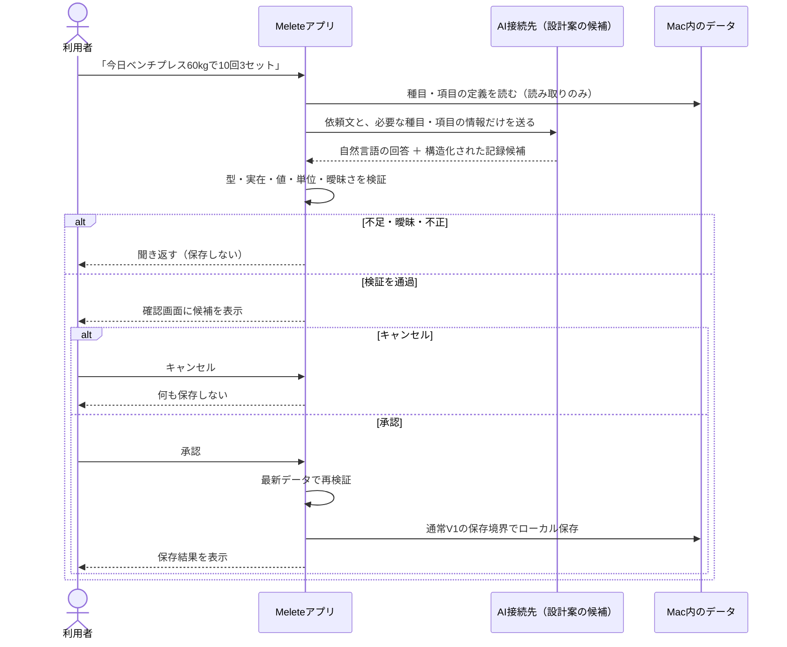
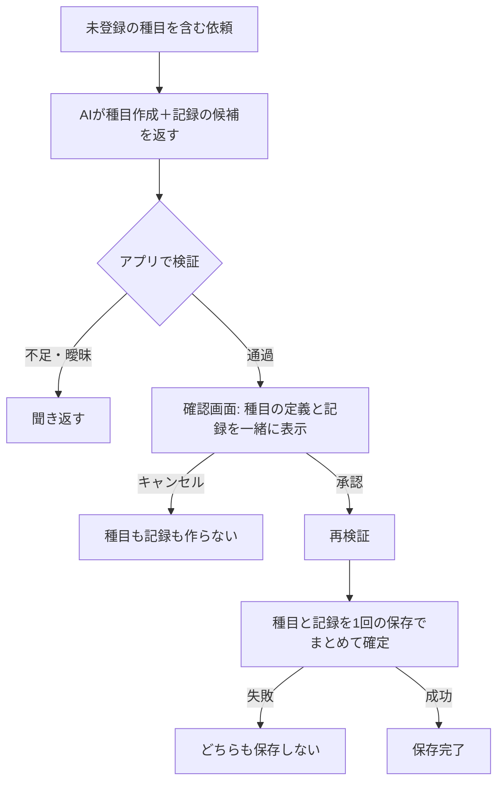

# 会話から運動記録を作る仕組み（設計メモ）

状態: 設計メモ（ユーザー確認待ち）。実装済み仕様ではない。
基準: 現行コード（`Melete/MainView.swift`、`Melete/Forms.swift`、`Melete/Models.swift`）と `docs/design-doc.md` 第7章（ユーザー確認待ちの設計案）
作成日: 2026-11-23

このメモは、「今日ベンチプレス60kgで10回3セット」のような会話から運動記録を作るときの流れと、安全のための考え方をまとめたものです。AI連携・確認画面・承認フローはどれもまだ実装されていません。以下の流れは `docs/design-doc.md` 7.2節の設計案を、具体例で説明し直したものです。

## 1. 現在の実装状況

「既にあるもの」と「これから作るもの」がはっきり分かれるよう、最初に現状を整理します。

| 区分 | 状態 | 根拠 |
|---|---|---|
| 通常V1の新規運動記録の保存 | **実装済み**。通常画面の記録フォームから使われる | `MainView.saveWorkout` → `WorkoutCreationV1.save`（`Melete/Models.swift`） |
| 通常V1の種目新規作成 | **実装済み**。運動記録とは別に、単独で保存する | `MainView.saveExercise` → `ExerciseCreationInContext.save` |
| V2スキーマ | **実験段階**。`--melete-v2-experimental` を付けた隔離ストアの起動でだけ使う。通常ストアはV1のまま | `StartupRoute`、`MeleteApp`、`MainView.StoreMode.isolatedV2Experimental` |
| AIへの接続・チャット | **未実装**。ホーム画面にも「目標・分析・設定・AIチャットは未実装です。」と表示している | `MainView.swift` |
| 構造化候補の検証・確認画面・承認 | **未実装** | 該当コードなし |
| 種目の新規作成と運動記録の同時保存（原子性） | **未実装**。2つの保存境界はそれぞれ独立して `save` を行う | `ExerciseCreationInContext` と `WorkoutCreationV1` |

### 1.1 通常V1の保存境界 `WorkoutCreationV1.save` が既に行っていること

AIの候補を保存するときに再利用を目指す部分なので、現行コードで何を確認しているかを書いておきます。

- 未保存の変更がある context では保存しない（`unsavedContext`）。
- 実施日が未来の日付でないこと、記録が1件以上あること、同じ種目が1回の運動記録内で重複しないこと。
- `WorkoutSetDraftEditing.validatedEntries` による値の検証。0以上の数値であること、整数項目に小数を入れていないこと（小数は第3位まで）、必須項目が空でないこと。任意項目の空欄は `nil` のまま扱い、0とは区別する。
- 別の読み取り用 context を使い、種目が1件だけ存在すること、アーカイブされていないこと、名前と有効な項目定義が入力開始時と一致することを確かめる（`staleDefinition`）。
- 保存に失敗したら `rollback` し、エラーを返す。成功したときだけ記録が残る。

入力は `WorkoutEntryDraft`（種目と、項目IDをキーにした文字列のセット値）です。AIの候補をこの形に変換できれば、通常画面と同じ検証を通せる見込みがあります。ただし、変換方法も、変換で問題が起きないかも、まだ検証していません。

## 2. 全体の流れ

例として、利用者が「今日ベンチプレス60kgで10回3セット」と入力した場合を考えます。



### 2.1 各ステップ

1. **入力を受け取る**: 利用者がチャットに自然な文章で書きます。
2. **送る情報を選ぶ**: アプリは、依頼に関係しそうな種目と、その項目（名前・単位・整数／小数・必須／任意）だけを選んでAIへ送ります。過去の記録をまとめて送ることはしません。どこまで送れば足りるか判断できないときは、多めに送るのではなく利用者に確認します（design-doc 7.2節の2）。
3. **AIが候補を返す**: AIは会話用の自然な文章とは別に、アプリが機械的に読める「構造化された候補」を返します。表示用の文章を解析して保存内容を決めることはしません。
4. **アプリが検証する**: AIの出力は信頼せず、アプリ側で検証します（3章）。
5. **確認画面を出す**: 種目、日付、セットごとの値と単位を表示し、利用者が承認またはキャンセルを選びます。
6. **承認時にもう一度検証する**: 確認画面を開いている間に種目や項目が変わっている可能性があるので、承認した時点の最新データで検証し直します。
7. **ローカルに保存する**: 通常画面と同じ `WorkoutCreationV1.save` の保存境界を再利用することを目指します。保存先はMac内のストアだけです。

## 3. 構造化候補とアプリ側の検証

### 3.1 候補のデータ構造（概念例）

> **注意**: 以下は説明のための概念例です。実際のAPIのリクエスト・レスポンス形式ではなく、確定した仕様でもありません。形式（JSON Schema、ツール呼び出しなど）は未決事項です。

```json
{
  "kind": "createWorkout",
  "day": "2026-11-23",
  "entries": [
    {
      "exerciseID": "（アプリが送った種目ID）",
      "sets": [
        { "values": { "（重量の項目ID）": "60", "（回数の項目ID）": "10" } },
        { "values": { "（重量の項目ID）": "60", "（回数の項目ID）": "10" } },
        { "values": { "（重量の項目ID）": "60", "（回数の項目ID）": "10" } }
      ]
    }
  ]
}
```

- 種目・項目を名前ではなく、アプリが送ったIDで指定してもらう案です。表記の揺れ（「ベンチ」「ベンチプレス」など）を保存時に解釈しなくて済みます。ID方式を採用するかは未決です。
- 「3セット」は、同じ値のセットを3つ並べる形で表します。現行の通常フォームにも、セットを複製してまとめて入力する操作があります。
- 数値を文字列にしているのは、現行の `WorkoutSetDraft.values` が文字列を受け取り、`MetricInput.parse` で検証しているのに合わせたためです。最終的な形は未決です。

### 3.2 アプリが検証すること

| 観点 | 内容 |
|---|---|
| 型 | 候補が想定した構造になっているか。知らない操作の種類やフィールドは受け付けない |
| 実在 | 指定された種目IDと項目IDが存在するか。アーカイブされていないか。その項目がその種目に属し、入力欄で有効になっているか |
| 値 | 0以上か、整数項目に小数がないか、小数第3位までか、必須項目が揃っているか。不正な値を丸めて保存しない |
| 単位 | 発言の単位（例: kg）と項目の単位が合っているか。合わないときに自動で換算しない（design-doc 5.1節の方針） |
| 日付 | 「今日」「昨日」をどのローカル日付と解釈したか。未来の日付は受け付けない |
| 曖昧さ | 当てはまる種目が複数ある、セット数がはっきりしない、など |

値・日付・実在の一部は `WorkoutCreationV1.save` が既に検証しています。ただし、検証を保存の直前まで先送りするのではなく、確認画面を出す前に一度、承認後にもう一度検証する流れを想定しています。

### 3.3 聞き返すケース

次のような場合は保存も確認画面の表示もせず、利用者に聞き返します（design-doc 9章「AIの提案が不完全・対象が曖昧」）。

- **値が足りない**: 「ベンチプレス3セットやった」のように、必須項目（重量・回数など）の値がない。
- **種目が分からない**: 登録済みの種目に当てはまるものがない。
- **種目が重複している**: 「ベンチプレス」と「ベンチプレス（ダンベル）」のように、候補が複数ある。
- **単位が合わない**: 「135lb」と言われたが、項目の単位がkgになっている。

## 4. 安全のための方針

### 4.1 AIにできること・できないこと

- AIは「候補を返す」だけで、記録DBへの直接書き込み、任意のファイル操作、コマンド実行は許可しない設計を目指します（design-doc 7.2節）。
- 保存を行うのはアプリだけで、必ず利用者の承認を経ます。
- **権限の境界は未検証です。** プロンプトで禁止するだけでは境界とみなしません。design-doc 7.2節に書いたとおり、接続方式が持つ制限を実際に適用・検証できない場合は、連携を有効にしません。

### 4.2 ログ・秘密情報・外部送信の同意

- 送信内容、AIの出力、実際の記録を、アプリのログ・テストデータ・コミットに含めません。認証情報も同様です。
- 外部へ送る情報の種類と目的を、初回利用時などに利用者へ説明し、同意を得てから送る設計とします。説明の場所と方法は未決です（design-doc 7.2節の2、12章の8）。
- 開発中の動作確認ではダミーデータを使います。実データを外部に送る確認は、利用者の明示的な許可を得てから行います。

### 4.3 二重実行・競合・複数変更

- **二重実行**: 承認ボタンの連打や再送で、同じ記録が2回保存されないようにします。具体的な仕組み（候補ごとの識別子、処理中は操作できなくする、など）は未決です。
- **競合**: 確認画面を開いている間に種目名や項目定義が変わった場合は保存せず、もう一度確認してもらいます。現行の `WorkoutCreationV1.save` は、こうした変化を `staleDefinition` として拒否します。
- **複数変更の原子性**: 1回の承認に複数の変更が含まれる場合は、全部保存するか、何も保存しないかのどちらかにします。現行の `WorkoutCreationV1.save` は、1回の運動記録に含まれる複数の種目・セットをまとめて保存し、失敗時に `rollback` します。一方、種目の作成と記録を一緒に保存する仕組みはありません（5章）。

### 4.4 失敗したとき

- 検証・保存のどこかで失敗した場合は保存せず、成功とも表示しません。理由を表示します。
- 保存に失敗したときは、利用者が入力した会話や確認中の候補を消さずに、やり直せるようにする方針です（design-doc 9章）。

## 5. 将来案: 未登録の種目と記録を一緒に承認する

design-doc の FR-09 と 7.2節の例にある構想です。**未実装です。**

「ベンチプレス」が未登録の場合、AIは種目（名前、重量/kg・回数/回などの項目）の作成と運動記録を、1つの候補として提案します。確認画面には種目の定義と記録の両方を表示し、利用者はまとめて承認またはキャンセルします。キャンセルした場合は、種目も記録も作りません。



現行コードでは、`ExerciseCreationInContext.save` と `WorkoutCreationV1.save` がそれぞれ未保存の変更がない context を前提にし、別々に `save` します。そのため、順番に呼ぶだけでは「種目だけ保存されて記録が失敗する」状態が起こり得ます。この案を実現するには、両方を1回の保存でまとめて確定する新しい保存境界を設計し、テスト専用の一時ストアで失敗時の動作を検証する必要があります。

## 6. AIの接続方式について

`docs/design-doc.md` 7.1節の設計案では、Codex CLI経由とSign in with ChatGPTによる直接接続の両方を用意し、利用者が設定でどちらを使うか選べるようにする構想です（FR-14）。選んだ方式が使えないときに、もう一方へ自動で切り替えることはしません。どちらの方式もまだ実装されておらず、利用条件・認証・安全な権限制御などの検証が必要なため、実現できるかは確定していません。このメモでは、両方式の認証・料金・利用条件について新しい判断はしていません。それらの確認状況と未検証の事項は、design-doc 7.1節と12章のとおりです。

構造化候補の検証・確認画面・保存は接続方式に依存させず、共通の仕組みにする方針です（design-doc 4章「AIアダプター」）。

## 7. 未決事項

1. **確認画面での編集**: 確認画面で利用者が値を直してから承認できるようにするか、キャンセルして聞き直すだけにするか。直せる場合、直した値の再検証をどこで行うか。
2. **送信対象の範囲**: 種目・項目の定義をすべて送るか、依頼文から候補を絞って送るか。過去の記録を送る必要がある依頼をどう扱うか。
3. **構造化候補の形式**: JSON Schema、ツール呼び出しなどのどれを使うか。接続方式ごとに対応状況が違う場合にどうするか。
4. **種目・項目の指定方法**: IDで指定してもらうか、名前で指定してもらいアプリが照合するか。
5. **日付の解釈**: 「今日」「昨日」「先週の月曜」などを、AIとアプリのどちらで暦日に変換するか。
6. **二重実行の防止方法**: 候補の識別子、処理中の操作制限など。
7. **1回の会話に複数の運動記録や他の操作が混ざる場合**: 例えば体重と運動記録。分けて承認するか、まとめて承認するか。
8. **V2の扱い**: V2が通常ストアに採用された場合、AI経由の保存はV2の保存境界（`WorkoutWritingServiceV2` など）を使うことになるか。現時点のV2は隔離ストアだけで使う実験段階のため、このメモはV1の保存境界を前提にしている。
9. **種目作成と記録を一緒に保存する境界**: 5章の将来案をどの単位で設計するか。
10. **送信内容の説明と同意の方法**: 初回だけにするか、送信のたびに示すか。設定画面に何を置くか。
