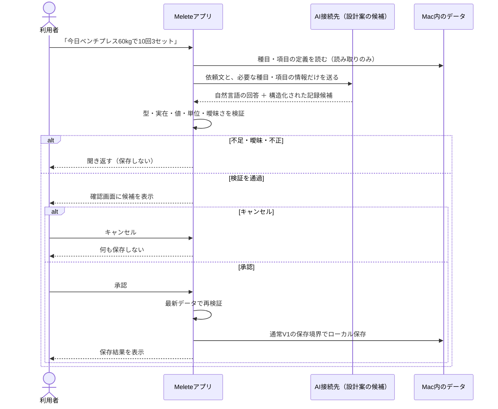
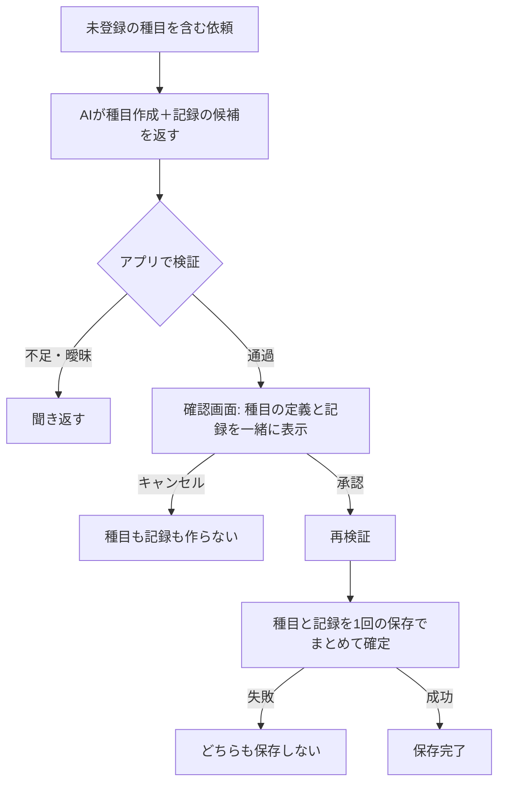

# 会話から運動記録を作る仕組み（設計メモ）

状態: 設計メモ（ユーザー確認待ち）。実装済み仕様ではない。
基準: 現行コード（`Melete/AIWorkoutProposal.swift`、`Melete/AIWorkoutProposalReviewForm.swift`、`Melete/AIWorkoutChatCoordinator.swift`、`Melete/AIWorkoutChatPresentation.swift`、`Melete/AIWorkoutChatView.swift`、`Melete/AIResponsesChatProvider.swift`、`Melete/AIResponsesHTTPTransport.swift`、`Melete/MainView.swift`、`Melete/Models.swift`）と `docs/design-doc.md` 第7章（ユーザー確認待ちの設計案）
作成日: 2026-11-23

このメモは、「今日ベンチプレス60kgで10回3セット」のような会話から運動記録を作る仕組みについて、設計案と現在の実装状況を区別して記録します。候補検証・確認フォーム・聞き返しcoordinator・presentation層は実装され、合成データと擬似providerを使うテストで検証されています。Responses API向けのproviderとHTTP transportの部品もありますが、テストから合成transport・合成endpointで使うだけで、認証情報の扱いは未実装です。実サービスへ接続する経路は通常画面に配線されていません。通常サイドバーの「チャットで記録」は、外部通信をしない固定台本のデモだけを開きます（1.2節）。実画面と実サービスを組み合わせた動作は未検証です。以下の全体フローや将来案は確定仕様ではありません。

## 1. 現在の実装状況

「既にあるもの」と「これから作るもの」がはっきり分かれるよう、最初に現状を整理します。

| 区分 | 状態 | 根拠 |
|---|---|---|
| 通常V1の新規運動記録の保存 | **実装済み**。通常画面の記録フォームから使われる | `MainView.saveWorkout` → `WorkoutCreationV1.save`（`Melete/Models.swift`） |
| 通常V1の種目新規作成 | **実装済み**。運動記録とは別に、単独で保存する | `MainView.saveExercise` → `ExerciseCreationInContext.save` |
| V2スキーマ | **実験段階**。`--melete-v2-experimental` を付けた隔離ストアの起動でだけ使う。通常ストアはV1のまま | `StartupRoute`、`MeleteApp`、`MainView.StoreMode.isolatedV2Experimental` |
| AIへの本番接続・通信 | **通信部品のみ実装。接続は未実装**。Responses API向けのprovider（`AIResponsesChatProvider`）と、固定の本番endpointへ送るHTTP transport（`AIResponsesHTTPTransport`）はある。ただし認証情報の取得・保管と通常画面への配線は未実装で、テストは合成transport・合成endpointだけを使う。実サービスとの相互運用は未確認 | `AIWorkoutChatCoordinator.swift`、`AIResponsesChatProvider.swift`、`AIResponsesHTTPTransport.swift`、`MeleteTests/AIResponsesChatProviderTests.swift`、`MeleteTests/AIResponsesHTTPTransportTests.swift` |
| 聞き返しcoordinator・presentation層 | **実装済み**。質問・回答履歴・送信状態・候補への接続を管理する。合成providerとmemory-only storeを使う合成テストで検証済み | `AIWorkoutChatCoordinator.swift`、`AIWorkoutChatPresentation.swift`、`MeleteTests/AIWorkoutChatCoordinatorTests.swift`、`MeleteTests/AIWorkoutChatPresentationTests.swift` |
| 構造化候補の検証・確認フォーム・承認 | **実装済み**。候補を検証してreviewを作り、数値を確認・修正して明示承認した場合だけ通常V1保存境界へ渡す。合成データのテストで検証済み | `AIWorkoutProposal.swift`、`AIWorkoutProposalReviewForm.swift`、`MeleteTests/AIWorkoutProposalTests.swift`、`MeleteTests/AIWorkoutProposalReviewFormTests.swift` |
| チャット画面 | **実装済み。通常画面からはデモとしてだけ開く**。実際のAIのproviderで構築する経路はない | `AIWorkoutChatView.swift`、`MainView.swift` |
| 通常サイドバーのチャット操作 | **デモのみ**。「チャットで記録」は外部通信なしの固定台本デモを開く。実AIへの送信はしない。詳細は1.2節 | `MainView.swift` の `chatDemoPane`、`AIWorkoutChatView.swift` の `AIWorkoutChatDemoSession` |
| 実画面と実サービスを組み合わせた動作 | **未検証**。合成テストの結果を本番providerや通常画面からの操作の検証とは扱わない | 上記各テスト、`MainView.swift` |
| 種目の新規作成と運動記録の同時保存（原子性） | **未実装**。2つの保存境界はそれぞれ独立して `save` を行う | `ExerciseCreationInContext` と `WorkoutCreationV1` |

### 1.1 通常V1の保存境界 `WorkoutCreationV1.save` が既に行っていること

AIの候補を保存するときに再利用を目指す部分なので、現行コードで何を確認しているかを書いておきます。

- 未保存の変更がある context では保存しない（`unsavedContext`）。
- 実施日が未来の日付でないこと、記録が1件以上あること、同じ種目が1回の運動記録内で重複しないこと。
- `WorkoutSetDraftEditing.validatedEntries` による値の検証。0以上の数値であること、整数項目に小数を入れていないこと（小数は第3位まで）、必須項目が空でないこと。任意項目の空欄は `nil` のまま扱い、0とは区別する。
- 別の読み取り用 context を使い、種目が1件だけ存在すること、アーカイブされていないこと、名前と有効な項目定義が入力開始時と一致することを確かめる（`staleDefinition`）。
- 保存に失敗したら `rollback` し、エラーを返す。成功したときだけ記録が残る。

入力は `WorkoutEntryDraft`（種目と、項目IDをキーにした文字列のセット値）です。実装では候補をこの形に変換して検証し、合成テストでその処理を確認しています。実サービスからの応答や通常画面との結合動作を検証したという意味ではありません。

### 1.2 通常画面のチャットのデモ（現行コード）

「チャットで記録」を開くと、画面に「デモ（合成AI・外部通信なし）」と表示したうえで、既存の `AIWorkoutChatView` を開きます。実際のAIの動作ではありません。

- **保存先**: `AIWorkoutChatDemoSession.make` が毎回新しく作る、memory-onlyのV1 storeだけです。このfactoryは外からcontainerを受け取りません。通常ストアやV2検証用ストアのcontext・種目は参照しません。チャット画面の `modelContainer` 環境もデモのcontainerに差し替えます。V2検証用の起動でも同じV1形式のデモ用メモリを使い、V2としては保存しません。
- **台本**: 外部通信はしません。入力文も解釈しません。新しい会話には固定の質問を返し、その回答には固定の合成種目と固定の合成値の候補を返します。日付は依頼時の今日です。候補の形式は現行の `createWorkout` で、通常の候補と同じ検証を通ります。入力した数値が候補に反映されないことを画面に表示します。
- **保存の条件**: 確認画面で「承認して保存」を押したときだけ、デモ用storeへ保存します。承認前と、確認画面でキャンセルしたときは何も保存しません。保存した記録は通常の履歴に反映されません。ウィンドウを閉じると消えます。
- **状態の保持**: デモは `MainView` の `@State` に1度だけ作って保持します。画面を切り替えても会話や確認中の候補は失われません。初期化に失敗した場合は固定のエラーを表示し、通常ストアへは切り替えません。
- **検証範囲**: `MeleteTests/AIWorkoutChatPresentationTests.swift` の `AIWorkoutChatDemoTests` に、memory-only storeだけを使う単体テストがあります。画面操作（GUI）での動作は未検証です。

## 2. 全体の流れ

以下は `docs/design-doc.md` の設計案を説明する概念フローです。通常画面から開けるのは固定台本のデモ（1.2節）だけで、実サービスへの接続は配線・認証とも未実装のため、現行アプリで実際のAIを使ってこの一連の操作を利用できるという意味ではありません。

例として、利用者が「今日ベンチプレス60kgで10回3セット」と入力した場合を考えます。



### 2.1 各ステップ

1. **入力を受け取る**: 利用者がチャットに自然な文章で書きます。
2. **送る情報を選ぶ**: アプリは、依頼に関係しそうな種目と、その項目（名前・単位・整数／小数・必須／任意）だけを選んでAIへ送ります。過去の記録をまとめて送ることはしません。どこまで送れば足りるか判断できないときは、多めに送るのではなく利用者に確認します（design-doc 7.2節の2）。
3. **AIが候補を返す**: AIは会話用の自然な文章とは別に、アプリが機械的に読める「構造化された候補」を返します。表示用の文章を解析して保存内容を決めることはしません。
4. **アプリが検証する**: AIの出力は信頼せず、アプリ側で検証します（3章）。
5. **確認画面を出す**: 種目、日付、セットごとの値と単位を表示し、利用者が承認またはキャンセルを選びます。
6. **承認時にもう一度検証する**: 確認画面を開いている間に種目や項目が変わっている可能性があるので、承認した時点の最新データで検証し直します。
7. **ローカルに保存する**: 通常画面と同じ `WorkoutCreationV1.save` の保存境界を再利用することを目指します。保存先はMac内のストアだけです。

## 3. 構造化候補とアプリ側の検証

### 3.1 候補のデータ構造（概念例）

> **注意**: 以下は説明のための概念例です。実際のAPIのリクエスト・レスポンス形式ではなく、確定した仕様でもありません。形式（JSON Schema、ツール呼び出しなど）は未決事項です。

```json
{
  "kind": "createWorkout",
  "day": "2026-11-23",
  "entries": [
    {
      "exerciseID": "（アプリが送った種目ID）",
      "sets": [
        { "values": { "（重量の項目ID）": "60", "（回数の項目ID）": "10" } },
        { "values": { "（重量の項目ID）": "60", "（回数の項目ID）": "10" } },
        { "values": { "（重量の項目ID）": "60", "（回数の項目ID）": "10" } }
      ]
    }
  ]
}
```

- 種目・項目を名前ではなく、アプリが送ったIDで指定してもらう案です。表記の揺れ（「ベンチ」「ベンチプレス」など）を保存時に解釈しなくて済みます。ID方式を採用するかは未決です。
- 「3セット」は、同じ値のセットを3つ並べる形で表します。現行の通常フォームにも、セットを複製してまとめて入力する操作があります。
- 数値を文字列にしているのは、現行の `WorkoutSetDraft.values` が文字列を受け取り、`MetricInput.parse` で検証しているのに合わせたためです。最終的な形は未決です。

### 3.2 アプリが検証すること

| 観点 | 内容 |
|---|---|
| 型 | 候補が想定した構造になっているか。知らない操作の種類やフィールドは受け付けない |
| 実在 | 指定された種目IDと項目IDが存在するか。アーカイブされていないか。その項目がその種目に属し、入力欄で有効になっているか |
| 値 | 0以上か、整数項目に小数がないか、小数第3位までか、必須項目が揃っているか。不正な値を丸めて保存しない |
| 単位 | 発言の単位（例: kg）と項目の単位が合っているか。合わないときに自動で換算しない（design-doc 5.1節の方針） |
| 日付 | 「今日」「昨日」をどのローカル日付と解釈したか。未来の日付は受け付けない |
| 曖昧さ | 当てはまる種目が複数ある、セット数がはっきりしない、など |

値・日付・実在などは候補からreviewを作る時点で検証され、承認時にもreviewの修正値を含めて `WorkoutCreationV1.save` の境界で再検証されます。この経路はコードと合成テストで実装済みです。実サービスからの候補受信は、provider・transportの部品はあるものの認証と通常画面への配線が未実装で、実サービスとの相互運用も未確認です。

### 3.3 聞き返すケース

設計案では次のような場合に利用者へ聞き返します。実装済みcoordinatorが質問として扱うのはproviderが所定形式で返した質問です。候補検証で値不足・種目不明・単位不一致などになった場合、現状はエラーとして依頼を終了し、自動でAIへ聞き返す処理はありません。

- **値が足りない**: 「ベンチプレス3セットやった」のように、必須項目（重量・回数など）の値がない。
- **種目が分からない**: 登録済みの種目に当てはまるものがない。
- **種目が重複している**: 「ベンチプレス」と「ベンチプレス（ダンベル）」のように、候補が複数ある。
- **単位が合わない**: 「135lb」と言われたが、項目の単位がkgになっている。

## 4. 安全のための方針

### 4.1 AIにできること・できないこと

- **設計案**ではAIは「候補を返す」だけとし、記録DBへの直接書き込み、任意のファイル操作、コマンド実行を許可しないことを目指します（design-doc 7.2節）。Responses API向けproviderの部品はありますが実サービスへは接続しておらず、この権限制御はまだ適用・検証されていません。
- 候補reviewの保存経路は明示承認を経る実装ですが、実サービスへの接続（認証・通常画面への配線）は未実装です。
- **権限の境界は未検証です。** プロンプトで禁止するだけでは境界とみなしません。design-doc 7.2節に書いたとおり、接続方式が持つ制限を実際に適用・検証できない場合は、連携を有効にしません。

### 4.2 ログ・秘密情報・外部送信の同意

- 送信内容、AIの出力、実際の記録を、アプリのログ・テストデータ・コミットに含めません。認証情報も同様です。
- 外部へ送る情報の種類と目的を、初回利用時などに利用者へ説明し、同意を得てから送る設計とします。説明の場所と方法は未決です（design-doc 7.2節の2、12章の8）。
- 開発中の動作確認ではダミーデータを使います。実データを外部に送る確認は、利用者の明示的な許可を得てから行います。

### 4.3 二重実行・競合・複数変更

- **二重実行**: 実装はリクエストIDごとにreviewを一元管理し、同一coordinatorインスタンス内で同じIDの応答からreviewを重複作成せず、保存成功後の再承認も拒否します。保存中の再入も拒否されます。ただし保証は同一アプリセッション内の同じcoordinatorインスタンスに限られ、複数coordinator間や再起動後の再送は防ぎません。別IDなら内容が同じでも別依頼として保存できます。ネットワークの自動再試行で同じ送信を続ける場合にIDを再利用する責務はprovider側に残っています。現行の `AIResponsesChatProvider` と `AIResponsesHTTPTransport` に自動再試行はありません。
- **競合**: 確認画面を開いている間に種目名や項目定義が変わった場合は保存せず、もう一度確認してもらいます。現行の `WorkoutCreationV1.save` は、こうした変化を `staleDefinition` として拒否します。
- **複数変更の原子性**: 1回の承認に複数の変更が含まれる場合は、全部保存するか、何も保存しないかのどちらかにします。現行の `WorkoutCreationV1.save` は、1回の運動記録に含まれる複数の種目・セットをまとめて保存し、失敗時に `rollback` します。一方、種目の作成と記録を一緒に保存する仕組みはありません（5章）。

### 4.4 失敗したとき

- 検証・保存のどこかで失敗した場合は保存せず、成功とも表示しません。理由を表示します。
- 保存に失敗したときは、利用者が入力した会話や確認中の候補を消さずに、やり直せるようにする方針です（design-doc 9章）。

## 5. 将来案: 未登録の種目と記録を一緒に承認する

design-doc の FR-09 と 7.2節の例にある構想です。**未実装です。**

「ベンチプレス」が未登録の場合、AIは種目（名前、重量/kg・回数/回などの項目）の作成と運動記録を、1つの候補として提案します。確認画面には種目の定義と記録の両方を表示し、利用者はまとめて承認またはキャンセルします。キャンセルした場合は、種目も記録も作りません。



現行コードでは、`ExerciseCreationInContext.save` と `WorkoutCreationV1.save` がそれぞれ未保存の変更がない context を前提にし、別々に `save` します。そのため、順番に呼ぶだけでは「種目だけ保存されて記録が失敗する」状態が起こり得ます。この案を実現するには、両方を1回の保存でまとめて確定する新しい保存境界を設計し、テスト専用の一時ストアで失敗時の動作を検証する必要があります。

## 6. AIの接続方式について

Codex CLI経由とChatGPTへの直接接続は `docs/design-doc.md` 7.1節にある設計案のままで、どちらも接続方式としては実装されていません。現行コードにはResponses API向けのprovider・HTTP transportの部品がありますが、認証と通常画面への配線は未実装で、実サービスとの相互運用も未確認です。利用条件・認証・安全な権限制御を含め、実現方法は確定していません。このメモでは料金や利用条件を推測・判断しません。

構造化候補の検証・確認画面・保存は接続方式に依存させず、共通の仕組みにする方針です（design-doc 4章「AIアダプター」）。

## 7. 未決事項

1. **確認画面での編集**: 数値の修正は実装済みで、承認時に再検証します。日付・種目・セット数は画面から変更できません。将来、編集対象を増やすかは未決です。
2. **送信対象の範囲**: 種目・項目の定義をすべて送るか、依頼文から候補を絞って送るか。過去の記録を送る必要がある依頼をどう扱うか。
3. **構造化候補の形式**: JSON Schema、ツール呼び出しなどのどれを使うか。接続方式ごとに対応状況が違う場合にどうするか。
4. **種目・項目の指定方法**: IDで指定してもらうか、名前で指定してもらいアプリが照合するか。
5. **日付の解釈**: 「今日」「昨日」「先週の月曜」などを、AIとアプリのどちらで暦日に変換するか。
6. **二重実行の拡張**: 現在の同一coordinator・同一セッション内の制御を、複数coordinatorやアプリ再起動をまたぐ場合にも拡張する必要があるか。永続化する場合はデータモデル・移行も含めて検討する。
7. **1回の会話に複数の運動記録や他の操作が混ざる場合**: 例えば体重と運動記録。分けて承認するか、まとめて承認するか。
8. **V2の扱い**: V2が通常ストアに採用された場合、AI経由の保存はV2の保存境界（`WorkoutWritingServiceV2` など）を使うことになるか。現時点のV2は隔離ストアだけで使う実験段階のため、このメモはV1の保存境界を前提にしている。
9. **種目作成と記録を一緒に保存する境界**: 5章の将来案をどの単位で設計するか。
10. **送信内容の説明と同意の方法**: 初回だけにするか、送信のたびに示すか。設定画面に何を置くか。
