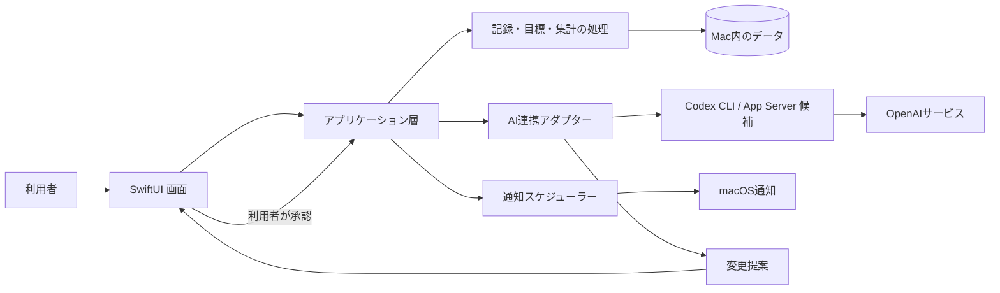
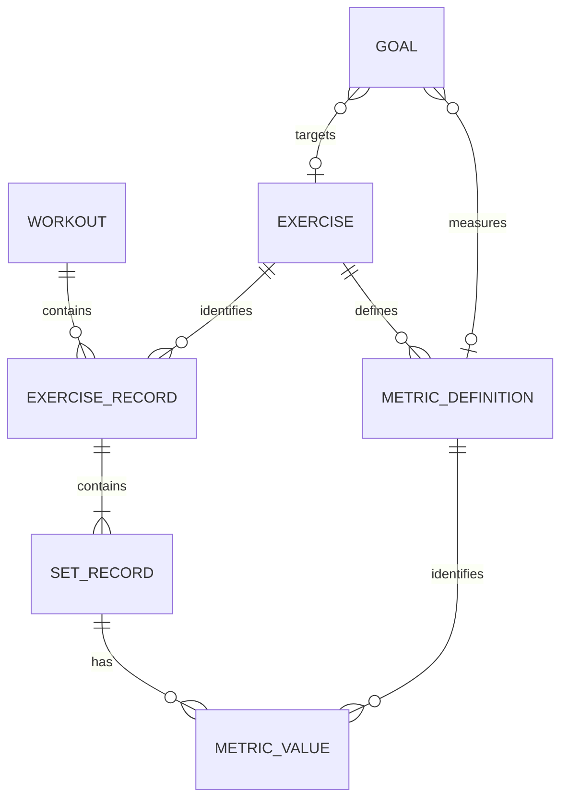

# Melete 設計書

状態: 設計案（ユーザー確認待ち）

作成日: 2026-11-14

## 1. 概要

Meleteは、筋力トレーニング、自重運動、有酸素運動、体重を記録するmacOSアプリである。運動後に内容をまとめて入力する使い方を中心とし、通常の画面操作とAIとの会話の両方から記録や目標を操作できるようにする。

最初は個人利用を優先する。将来はOSSとして公開・配布できる構成とし、当面はMac以外の端末や同期用サーバーを対象としない。

### 1.1 目的

- セットごとに異なる重量・回数や、時間・距離などを記録し、後から振り返れる。
- 利用者が種目と記録項目を自由に組み合わせられる。
- 会話で記録・目標を操作し、記録に基づく進捗やメニューの提案を受けられる。
- AIの提案による保存・変更・削除は、利用者が内容を確認してから行う。
- AIが使えないときも、通常画面からの記録・閲覧・編集を続けられる。

### 1.2 初期版の対象外

- iPhone対応、端末間同期、複数ユーザー、独自サーバー。
- バックアップ・エクスポート・インポート機能。将来追加するため、データの識別子・スキーマバージョンと移行を考慮する。初期版には専用の復旧手段がない。
- AIとの会話履歴の保存。自動声かけの短い結果だけは再利用のため一時保存する。
- おすすめメニューの予定保存や、自動での運動記録への反映。
- 条件付き自己ベスト（例: 同じ距離での最短時間）。
- 医療上の診断、怪我の治療、安全な運動の保証。

## 2. 要求と受入条件

FRは機能要件、NFRは非機能要件を表す。未確定の詳細は第12章に記載する。

| ID | 要求 | 受入条件 |
|---|---|---|
| FR-01 | 記録の追加・編集・削除 | 日付、種目、セットごとの値を入力し、保存後に履歴から確認・修正・削除できる。1つの運動日に複数種目を記録できる |
| FR-02 | セット別の記録 | 同じ種目内で100kg×5回と95kg×6回を記録できる。同じ値の複数セットはまとめて入力できる |
| FR-03 | 種目のカスタマイズ | 初期状態では種目は空。数値項目・単位を組み合わせて種目を作成でき、種目設定の変更後も過去の記録を当時の値・単位で表示できる |
| FR-04 | 体重 | 日付と体重を記録・編集・削除でき、推移を確認できる。体重の記録だけでは運動日とみなさない |
| FR-05 | 目的 | ダイエット、筋力アップ、健康維持を複数選択できる。初回はスキップ可能で、後から変更しても記録・目標は削除されない |
| FR-06 | 目標 | 期限付きの種目別・体重目標、運動頻度・継続目標を設定・編集・削除できる。達成済み・期限切れも履歴に残る |
| FR-07 | 振り返り | 日付別履歴、運動日カレンダー、種目の項目別推移、体重推移、選択した数値項目の最大値を表示する |
| FR-08 | AIチャット | ホームのチャットから、運動・体重記録および目標の追加・修正・削除を依頼できる。AIが提案した各変更は、対象と変更内容の確認・承認なしに実行しない |
| FR-09 | AIによる種目提案 | 未登録種目を含む依頼では、AIが項目・単位を含む種目作成と記録を提案できる。承認前にどちらも作成しない |
| FR-10 | AIによる提案 | ホームのボタンを押したときにおすすめメニューを表示する。表示だけで予定や運動記録を作成しない |
| FR-11 | AIの自動声かけ | 起動時、目標の状況についてチャットに声をかける。オフにでき、同じ日で関連データが変わらなければ保存した結果を再利用する |
| FR-12 | 進捗の見通し | 過去の情報と期限から得た見通しは推定として表示し、情報不足は遅延と区別する。未評価を遅延とみなさない |
| FR-13 | 運動の通知 | 最初の運動記録前は通知しない。最後の運動から設定日数が空けば、次の運動記録まで毎日通知する。初期値は7日・20時、日数・時刻・オンオフを変更できる |
| NFR-01 | ローカル利用 | 通常画面での記録・閲覧・編集・目標操作はインターネット接続なしで利用できる |
| NFR-02 | AI連携の独立性 | Codex未導入・未認証・通信失敗時、AIの状態を表示し、通常画面のローカル機能を維持する |
| NFR-03 | プライバシー | 記録と目標はMac内に保存し、AI利用時に必要な情報を外部へ送る。認証情報や個人の実記録をリポジトリ・テスト・ログへ含めない |
| NFR-04 | 会話の保持 | アプリにチャット履歴を保存しない。自動声かけ結果は当日分を一時保存できる。Codex側・サービス側の保持は別途検証する |
| NFR-05 | データの維持 | アプリ再起動後も保存済みデータを読み込める。更新時のスキーマ移行を考慮し、将来のバックアップ機能を妨げない |

## 3. 画面と操作

初期版はmacOS 14以降を対象とする。SwiftUIを第一候補とし、macOSの標準的なナビゲーション・設定・通知を用いる。具体的なレイアウトは実装時の画面確認を経て調整する。

| 画面 | 内容 |
|---|---|
| ホーム | 直近の運動、目標、常設チャット、おすすめメニュー生成ボタン |
| 記録 | 日付別履歴、運動カレンダー、運動・体重の追加・編集・削除 |
| 分析 | 種目の選択項目別の推移、自己ベスト、体重の推移 |
| 目標 | 目標の作成・編集・削除、進捗、達成済み・期限切れの履歴 |
| 種目 | 空の状態から種目と記録項目を追加・編集。過去の記録に影響する変更は説明する |
| 設定 | 利用目的、Codex連携状態、自動声かけ、通知の有効・日数・時刻 |

初回の目的・目標設定はスキップできる。各一覧が空の場合は、該当データがまだないことと追加への導線を表示する。チャットはアプリを閉じるまでの会話文脈を持ち、再起動後に以前の会話を復元しない。

## 4. 全体構成

- **画面**: 入力、表示、AI提案の確認を担当する。
- **アプリケーション層**: 操作の検証・保存・集計・AI連携を調整する。AI経由でも通常画面と同じ検証を使う。
- **ドメイン処理**: 単位や項目、目標の状態、日付、自己ベストなどのルールを扱う。
- **保存**: 運動、体重、種目定義、目標、設定、自動声かけキャッシュを保持する。SwiftDataを第一候補とするが、対応macOS、移行および可変項目の扱いを確認して確定する。
- **AIアダプター**: 利用者がインストールしてログインしたCodex CLIとの接続を担当する。インターフェースを分離し、将来別の接続先を検討可能にする。初期版ではCodex以外を実装しない。
- **通知**: 最後の運動日と設定に基づいてmacOS通知の予約・更新・取り消しを行う。

保存先はアプリ専用のローカル領域を候補とする。自動同期を有効にしない。具体的な配置とサンドボックス設定は未確定である。Appleの資料によるとSwiftDataはmacOS 14以降で利用できるが、採用・移行方法は未確定である。

## 5. データモデル

以下は論理モデルであり、SwiftDataのクラスやDBテーブルを直接指定するものではない。各実体は安定したIDを持つ。

| 実体 | 主な情報 | 方針 |
|---|---|---|
| 運動 `Workout` | ID、運動日、種目別記録 | 運動日ごとに振り返れる。作成日時と実際の運動日を区別する |
| 種目 `Exercise` | ID、表示名、項目定義、状態 | 初期値は空。記録済み種目を使わなくする場合も過去の参照を壊さない |
| 項目定義 `MetricDefinition` | ID、名称、単位、必須かどうか、表示順 | 値は数値。例: 重量/kg、回数/回、時間/分、距離/km |
| 種目別記録 `ExerciseRecord` | 運動ID、種目ID、セット | 1日の複数種目と、同一種目の複数セットを扱う |
| セット `SetRecord` | ID、順序、項目値 | セットごとに異なる値を保持する |
| 項目値 `MetricValue` | 項目ID、数値、記録時の名称・単位 | 定義の変更後も過去の表示を維持する。未入力と0は区別する |
| 体重 `BodyWeight` | ID、測定日、体重、単位 | 運動と独立して保存する |
| 目標 `Goal` | ID、種類、対象、目標値、期限、必要な条件 | 対象種目・項目を識別子で参照する。達成判定の詳細は第6章 |
| 設定 | 利用目的、通知、AIの自動声かけ | 複数目的を保持し、未設定も許す |
| 声かけキャッシュ | ローカル日付、関連データの変更識別子、短い結果 | 関連データの変更または日付変更で無効化。チャット全文は保存しない |

### 5.1 カスタム項目と過去データ

- 種目は数値項目を複数持つ。表示名や単位の変更が過去の値を黙って変換したり、異なる尺度を単純比較したりしない。
- 項目の実質的な意味や単位を変える場合、過去の定義と新しい定義を区別する。互換性が確認できない値は、グラフや最大値で混ぜない。単位換算を提供するかは未決定である。
- 種目や項目の削除によって過去記録が消えないよう、削除とアーカイブ、参照中の変更可能範囲を実装前に確定する。
- 入力可能な数値範囲、必須項目、整数・小数の扱い、単位一覧や自由入力の範囲は未決定。入力エラー時に不正な値を保存しないことを共通条件とする。

## 6. 目標と分析

### 6.1 目標

初期版では少なくとも次を扱う。

- **種目別目標**: 対象種目、測定項目、目標値、期限。重量だけでなく「100kgを1回」のような達成条件を表現できるよう、対象項目以外の条件も扱う。
- **体重目標**: 目標体重、期限、開始時点と方向。体重増加・減少のどちらも扱えるようにする。
- **頻度・継続**: 「週3回」「週1回を3か月」のような目標を初期版に含める。週はローカル日付の月曜から日曜とし、運動した日数を数える。同じ日に複数回運動しても1日として数え、体重のみの記録は含めない。継続目標を週の途中で設定した場合は次の月曜日から、月曜日に設定した場合はその日から数える。3か月は開始日から暦の3か月間とし、期限が週の途中なら、その週は期限日までに目標日数を満たすことで達成とする。期限日の算出方法・途中変更の扱いは未確定。

状態は進行中・達成済み・期限切れを基本とし、記録の追加・修正・削除によって再評価する。期限切れ後に達成した場合、複数条件の判定、同日複数記録、目標作成前の記録を対象に含めるかは未決定である。AIの見通しと、記録に基づく達成状態は区別する。

### 6.2 推移と自己ベスト

- カレンダーは運動記録がある日を示し、体重のみの日を運動日としない。
- 種目の数値項目を選んで推移を表示する。セット値を日ごとにどう集約するか、全セットを表示するかは画面設計で決め、表示上その意味を明記する。
- 自己ベストは選択した数値項目の最大値とし、対象種目・項目・単位を表示する。記録がなければ未記録とし、0を仮の値にしない。
- 小さいほどよい指標、条件付きベスト、推定最大挙上重量は初期版の自己ベスト要件に含めない。

## 7. AI連携と安全な操作

### 7.1 接続と認証

利用者がCodex CLIをインストールしてChatGPTアカウントでログインする方法を第一候補とする。OpenAIのCodex App Serverは製品への組み込み用インターフェースとして文書化され、ローカルの標準入出力で通信できる。Meleteからの利用におけるサブスクリプションの適用条件、配布時の制約、利用枠、利用者のCLIバージョンとの互換性は未確認であり、実装前に確認する。

公式資料はApp ServerのChatGPTログイン・認証状態の取得を説明しているが、既存CLIのログインを必ず再利用できるとは確認できていない。また、既存のローカルまたはOSSアプリのApp Server認証は継続利用可能としつつ、Sign in with ChatGPTへの移行を推奨し、商用・ホスト型サービスのApp Server認証は許可されていなかったと記載している。これを新規アプリや将来の商用配布への包括的な許可と解釈せず、利用条件を確認する。

APIキー方式は標準API料金となることが公式認証資料に記載されている。希望するサブスクリプション認証が利用できない場合に、別料金のAPIキー方式へ自動的に切り替えない。

### 7.2 読み取り・変更の境界

1. 利用者の入力やおすすめ生成の操作に応じ、アプリが対象となるデータを用意する。
2. 依頼に必要な情報だけをCodex側に渡す。送信される情報の種類と利用目的を設定・初回利用時などで説明する。必要な範囲を決められない場合は過剰に送らず、確認を求める。
3. AIは回答または構造化された変更案を返す。AIの出力は信頼せず、アプリで型・対象・値・権限を検証する。
4. 変更案の対象、旧値と新値、削除内容、新規種目と記録を画面に表示する。利用者が承認またはキャンセルする。
5. 承認時に対象の存在・バージョン・入力値を再検証し、変更を保存する。確認中に対象が変更・削除されていた場合は上書きせず、再確認を求める。
6. 新規種目と運動の同時作成など複数変更をまとめて承認した場合は、全件成功または全件失敗となるように保存する。再送による二重登録も防ぐ。

AIには記録DBや任意のファイルへの直接書き込み、コマンド実行を許可しない設計を目指す。Codexが提供するサンドボックス・ツール無効化・実行権限を確認し、要求した制限を実際に適用・検証できない場合は連携を有効化しない。プロンプトで禁止するだけでは境界とみなさない。公式のセキュリティ資料では、read-onlyモードでも許可されたコマンドは実行され、アクセス可能なファイルを読めると説明されているため、read-only指定だけではこの要件を満たさない。

例: 未登録の「ベンチプレスを100kgで5回、5セット」を受けた場合、種目名・重量と回数の項目・5セットの内容を同じ確認画面に表示する。キャンセルした場合は種目も記録も作成しない。対象や値が曖昧なときは確認する。

### 7.3 チャットと自動声かけ

- 会話はアプリ内ではセッション中のみ保持する。再起動後、会話全文は復元しない。Codex側のローカル履歴、ログ、サービス側の保持はこの方針だけでは保証できず、公式仕様と実機で確認する。
- 自動声かけが有効なら、起動時に目標と進捗を確認し、AIが状況を伝える。目標が未設定なら進捗確認のためのAI呼び出しは行わない案とする。
- 同じローカル日付で対象の記録・目標が変わっていなければ、保存した短い声かけを再利用する。日付や関連データが変われば再生成する。失敗・未取得と成功結果を区別し、古い内容を最新と表示しない。
- コンテキストは関連する目標と必要な期間の記録・集計に絞る。対象期間と要約方法は未決定。削減が判断の根拠を損なわないこと、利用枠・通信失敗時の挙動を検証する。
- AIによる見通しは推定であり、情報不足はそのまま伝える。提案は診断・安全性・達成の保証として表示しない。

### 7.4 おすすめメニュー

「おすすめを作成」ボタンが押されたときに生成する。利用目的、関連する運動履歴、目標など必要な情報を使う。表示後に予定や記録として自動保存しない。情報不足の場合は不足を説明する。怪我や体調の詳細を収集する機能は未決定であり、取得していない情報を推測しない。

## 8. 通知

- 有効時、最初の運動記録後から、最後の運動日を基準に設定日数が経過した場合に毎日通知する。初期値は7日、通知時刻は20時。例えば1日に運動した場合、最初の通知は8日20時とする。利用者が日数・時刻を変更でき、通知自体を無効にできる。
- 運動記録は実施済みの内容とし、未来日付を登録できない。過去日付での登録は可能とする。
- 新しい運動の保存、過去日付の追加、運動日の修正、削除、設定変更時には最後の運動日を再計算し、保留中の通知を更新する。体重の記録は条件に含めない。
- 通知の表示にはmacOS側の許可が必要である。拒否・未許可時はアプリ内で状態を区別し、記録機能は継続する。
- 予約済みローカル通知は、Appleの資料上、アプリ終了中でもシステムが配信する。Macの電源断・スリープ・集中モード、タイムゾーン変更、長期未起動時の毎日通知と予約更新の実動作は未検証。
- Appleのカレンダートリガーは時刻を指定した繰り返しに対応する。ただし、確認した資料では「7日後に開始し、その後毎日」を単一の予約で設定する方法は確認できていない。7日後の単発通知を受けてアプリが次の繰り返しを登録する方式も、アプリ終了中に登録処理が動くことは保証されない。長期未起動時にも毎日通知できる方式を、予約上限を含めて設計・実機検証する。
- 設定変更や運動保存後に古い通知が残らないこと、再予約の失敗、削除により記録がなくなった場合の扱いをテストする。

## 9. エラーと境界

| 状況 | アプリの扱い |
|---|---|
| 保存値が不正・必須項目不足 | 保存せず、対象項目と理由を表示する |
| AIの提案が不完全・対象が曖昧 | 操作を実行せず、不足情報を聞き返す |
| 確認前に対象が変更された | 上書き・削除せず、最新状態を示して再確認する |
| Codex未導入・未認証・利用枠超過・通信失敗 | 区別できる範囲で状態を示し、AI機能を使えないことを伝える。通常機能は維持する |
| 保存中の障害 | 成功表示をせず、入力を維持できるようにする。複数件変更の部分保存を避ける |
| 通知が未許可・拒否 | 通知状態を表示する。記録と目標の利用は妨げない |
| 目標のデータ不足 | 未評価または情報不足とし、遅延や達成済みと断定しない |

## 10. 検証計画

### 単体・統合テスト

- セットごとの異なる値、一括入力、未入力と0、数値の境界、保存・再起動後の復元。
- 種目・項目の変更後の過去値と単位、互換性のない項目をグラフ・最大値で混ぜないこと。
- 目標の作成・変更・削除、期限、達成、記録修正後の再評価、情報不足。
- AI提案の型・対象検証、未承認・キャンセル時の無変更、確認中の競合、二重送信、複数変更の原子性。
- 目標未設定、自動声かけオフ、当日キャッシュ再利用、日付・関連データ変更時の無効化、失敗時の古い結果の扱い。
- 最初の記録前、最終運動日の変更、体重のみ、通知設定変更、通知取り消し・再予約。日時テストでは固定時計とタイムゾーンを使う。
- ネットワークなし、Codexなし・未認証・エラー時に通常の記録操作が継続できること。

### 実機での確認

- 実アプリのホーム・記録・分析・目標・種目・設定の操作、グラフと確認画面の表示。
- 実際のmacOS通知許可、アプリ終了後の配信、起動後の予約更新。電源断・スリープ等は確認できた条件を明記する。
- Codexのインストール・ログイン・プラン条件・権限境界・履歴保存・アプリ接続を、実データの外部送信前に承認を得たうえで確認する。モックの成功を実サービスの成功と扱わない。

## 11. 実装の進め方

1. 外部仕様と未決事項を解消し、最低macOS・永続化方式・Codex接続方法を決める。
2. アプリ基盤とローカルデータモデルを用意し、運動・種目・体重の通常画面操作を実装する。
3. 目標、履歴、カレンダー、グラフ、最大値を実装する。
4. 通知を実装し、アプリ終了時を含めて実機で検証する。
5. Codex接続、チャット、確認付き変更、提案、自動声かけを順に接続する。未確認の認証・保持・権限制御を前提に実装済みとしない。
6. ローカル機能とAI失敗時の通し操作、テスト、静的解析、ビルドを確認する。

順序は計画であり、各段階の完了条件と具体的なファイル構成は、技術選定後の実装計画で確定する。コミット・公開は別途依頼された場合のみ行う。

## 12. 未決事項

1. Codex App Serverをこの用途でChatGPT契約枠から利用する条件、認証・料金・利用枠、サポート範囲。公式料金ページはCodexのCLI利用とChatGPT契約枠の関係、契約枠とAPI課金の違いを説明しているが、Meleteのような外部アプリでの利用条件までは確認できていない。
2. Codexの会話・ログのローカルおよびサービス側保持、アプリを閉じた後に保存を残さない手段。公式ソースの `thread/start` に `ephemeral` フィールドがあることと、ローカルCLIの `codex exec --ephemeral` がセッションファイルをディスクに残さないというヘルプは確認済み。ただし前者の実際の保存・ログやサービス側の保持については未検証。
3. Codexの任意コマンド・ファイル・ネットワークアクセス等を必要な範囲に制限する具体策、macOSサンドボックスと外部CLIの両立、権限制御の実証方法。
4. SwiftData採用可否・移行方式、保存先、配布・署名方式。最低対応OSはmacOS 14とする。
5. 頻度・継続目標の計算方法。種目別目標の複数条件、期限後達成、過去の記録の扱い。
6. カスタム項目の数値範囲・型・単位、削除・アーカイブ、互換性とグラフの日単位集約方法。
7. 電源断・スリープ・タイムゾーン変更、長期未起動時の配信。未来日付の運動記録は不可、通知日数の境界と20時の初期値は合意済み。
8. 進捗要約に含める期間・情報、自動声かけキャッシュの保存期間・削除タイミング。利用者に示す送信内容と設定方法。
9. トレーニング全体のテキストメモの要否。数値以外のカスタム項目は初期版の対象外。

## 13. 参考資料

確認日: 2026-11-14。外部サービスの条件は変わるため、実装前に再確認する。

- [Codex App Server](https://developers.openai.com/codex/app-server/): 製品への組み込み、標準入出力、認証・スレッド等。アプリ固有の認証・保持・権限条件までは確認できていない。
- [Codex App Server protocol: thread.rs](https://github.com/openai/codex/blob/main/codex-rs/app-server-protocol/src/protocol/v2/thread.rs): `ThreadStartParams` に `ephemeral` を定義。参照先はmainブランチであり、利用者のCLIバージョンとの互換性と動作は未検証。
- [Codex Authentication](https://developers.openai.com/codex/auth/): CodexのChatGPTログインとAPIキー方式。APIキーは標準API料金と説明されている。
- [Agent approvals & security](https://developers.openai.com/codex/agent-approvals-security/): サンドボックスと承認の動作。read-onlyモードでも許可されたコマンドは実行できる。
- [Codex Pricing](https://developers.openai.com/codex/pricing/): Codex CLIとChatGPTプランの利用条件・枠についての説明。外部アプリの具体的条件は未確認。
- [Scheduling a notification locally from your app](https://developer.apple.com/documentation/usernotifications/scheduling-a-notification-locally-from-your-app): ローカル通知の予約・配信・キャンセル。停止・スリープ等の個別条件は未確認。
- [UNCalendarNotificationTrigger](https://developer.apple.com/documentation/usernotifications/uncalendarnotificationtrigger): カレンダー条件による通知と繰り返し。開始日を遅延させた毎日通知の実現方法は未確認。
- [SwiftData](https://developer.apple.com/documentation/swiftdata): Appleのデータ永続化フレームワーク。macOS 14以降に対応。採用の可否は未確定。
